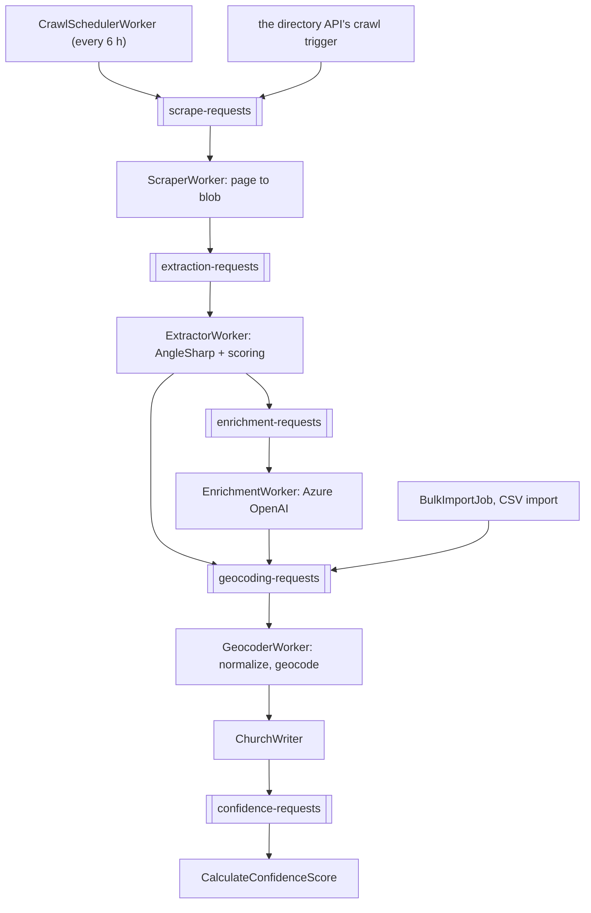

# Architecture

## Bird's-eye view

One Azure Functions app (isolated worker, .NET 10) carries three workloads that share a host and nothing else: the
church-directory pipeline (`Functions/Churches`), the curation service's background jobs (`Functions/Curator`), and
email delivery (`Functions/Notifications`). Work arrives as Service Bus messages, timers and two admin HTTP endpoints.
Each workload owns its domain folder; host-wide wiring stays at the project root.

## Codemap

| Part | What it does |
|---|---|
| `Functions/Program.cs` | the host and the production-only branch: Azure OpenAI credential, Serilog to Elasticsearch, OpenTelemetry, data protection |
| `Functions/Curator/CuratorServiceCollectionExtensions.cs` | everything else the container holds: Azure clients, both databases, Redis, repositories, typed HTTP clients, Resend |
| `Functions/Churches` | the church pipeline, by slice: `Crawling`, `Extraction`, `Geocoding`, `Confidence`, `Import`, `Moderation`, `Publishing`; `ChurchWriter`, `Normalizer` and the shared constants at the domain root |
| `Functions/Curator` | the curation jobs, by slice: `Jobs` (leasing, scheduling, reaping), `Library` (refresh and continuation), `Enrichment`, `Catalog` (canonicalization), `Psn`, `Rawg`, `OpenCritic`, `Store` (storefront passes) |
| `Functions/Notifications/Email.cs` | sends each `email` queue message through Resend |
| `Functions/ServiceBusSettlement.cs`, `ExceptionHandlingMiddleware.cs`, `Telemetry.cs`, `PostgresConnectionString.cs`, `Extensions` | message settlement, unhandled-exception counting, the meter and span helpers, Postgres URI normalization, configuration helpers |
| `Functions/host.json` | timeouts, Service Bus lock renewal and concurrency, OpenTelemetry mode for the host |
| `Functions.Tests.Unit`, `Functions.Tests.Integration` | the two test tiers ([TESTING.md](TESTING.md)) |
| `.github/workflows/main_crgolden-functions.yml` | build, inspect, test, analyze and deploy |
| `coverage.settings.xml`, `dotnet-tools.json`, `NuGet.Config`, `global.json` | coverage scope, pinned tools, package sources (the `Shared` package from GitHub Packages), the SDK |
| `gate.ps1` | the maintainers' local gate (README.md, "Gate") |

## Invariants

- **`ChurchWriter` is the only writer of church rows**, one transaction per write, serialized per crawl source with an
  application lock, with a duplicate guard on name, city, state and coordinates, because Service Bus delivery is
  at-least-once.
- **Every Service Bus trigger settles its own message** (`AutoCompleteMessages = false`), always through
  `ServiceBusSettlement` and with `CancellationToken.None`, because instance teardown cancels the invocation token first.
- **A malformed payload dead-letters with reason `malformed-payload`**; it is never completed silently.
- **Every curation job runs inside `LeasedJobRunner`**, which owns claiming the `job_runs` row (one compare-and-swap
  statement), the lease and its heartbeat, the terminal write and settlement; handlers never touch the broker. A
  terminal write that changes no row means someone else moved the run, and the message settles without work.
- **Advisory lock classes match the curation API's own**, so the two runtimes serialize the same work.
- **The encrypted-token format is shared byte for byte with the curation API** (README.md, "Data at rest").
- **This app never creates or migrates a PostgreSQL table**; the curation API owns that schema.

## The church pipeline

- **The extractor is the cost gate.** A page the extractor reads with confidence at or above 0.5 and a city goes
  straight to geocoding; only the rest pay for a model call. The extractor sends the page text itself (at most
  12,000 characters, from at most 200,000 of HTML), so enrichment never downloads the page.
- **Enrichment waits outside the invocation.** A shared Redis rate gate sized to the deployment's limits admits
  each call; with no room, or on a 429, the message is rescheduled with a growing delay and, past its limit,
  degrades to the extractor's partial data rather than dead-lettering.
- **Geocoding drops what can never be valid.** A record with no resolvable state, zip, name or city completes with a
  trace event. A zip is backfilled from city and state first; a Census miss, or a request with no street, stores
  `(0,0)`, which `ReGeocodeJob` revisits.
- **A dead site is not an error.** An expected fetch failure marks the crawl source failed and completes the message,
  so the next scheduler pass retries it; an unexpected one also abandons and rethrows.
- **Duplicates are suggested, never merged.** `DeduplicationJob` (nightly) pairs active churches within 0.1 mile
  whose names score at least 0.85 Jaro-Winkler, and writes one merge suggestion per duplicate for a moderator.
- `SitemapGenerator` (nightly) writes `sitemap-index.xml` and gzip-compressed chunks of 50,000 URLs to blob static
  hosting; the web app serves them under its own origin.

## Boundaries

- Inbound: Service Bus queues, timers, and `bulk-import` and `re-geocode` (admin key).
- Outbound: SQL Server, PostgreSQL, Redis, Blob Storage, Service Bus, Azure OpenAI, the Census geocoder, RAWG,
  OpenCritic (RapidAPI), the PlayStation Network, the PS Store web storefront, Resend.
- Storage and Service Bus refuse shared keys: a local host uses the developer's `az login`, production its managed
  identity.

## Cross-cutting concerns

- **Billed time is invocation time** on the Flex Consumption plan, so waiting is designed out: the OpenAI client does
  not retry inside an invocation, rate-limited work is rescheduled onto its queue instead of sleeping, and long jobs
  stop at a 20-minute budget and continue in a new message.
- **Every rate limit is shared in Redis** (OpenAI, PSN, RAWG, OpenCritic), so all instances draw from one budget.
- **Handled failures are span events and counters**, never log lines; the host and the worker export telemetry
  separately in production.
- **Warnings are errors**, and CI also fails on any `jb inspectcode` result and any open SonarCloud issue.
